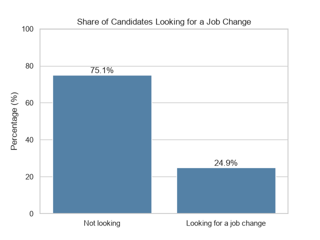
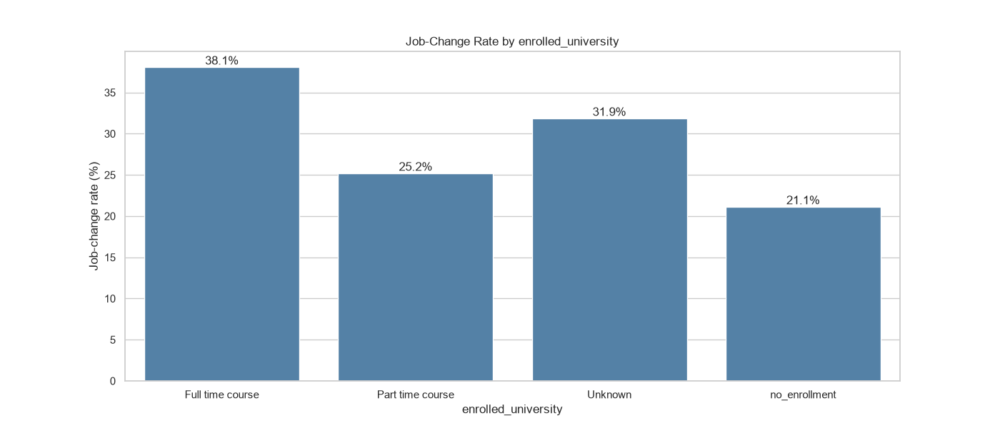

# HR Analytics: Job Change Analysis

Explore how candidate characteristics relate to job-change intent in an HR analytics dataset.

## Dataset

- **Source:** [Kaggle: HR Analytics Job Change of Data Scientists](https://www.kaggle.com/datasets/arashnic/hr-analytics-job-change-of-data-scientists)
- **Files:** `aug_train.csv` (original) and `HR_clean.csv` (cleaned)
- **Size:** 19,158 rows and 14 columns
- **Target:** `target` — 1 means looking for a job change; 0 means not looking
- **Cleaning result:** all rows retained; no missing values or duplicate rows in `HR_clean.csv`

## Questions answered

1. What percentage of candidates are looking for a job change?
2. How does relevant experience relate to job-change intent?
3. How does university enrollment relate to job-change intent?
4. How do city development index and training hours correlate with the target?
5. How does job-change intent vary by years of experience?

## Tools used

Python, Pandas, NumPy, Seaborn, Matplotlib, and Jupyter Notebook.

## Key findings

1. **Overall target:** 24.9% (4,777 candidates) have `target = 1`; 75.1% (14,381) have `target = 0`.
2. **Relevant experience:** job-change intent is 21.5% among candidates with relevant experience and 33.8% among those without it.
3. **Correlation:** city development index has a negative correlation with the target (**r = -0.34**), while training hours have almost no correlation (**r = -0.02**).

The experience analysis also shows a general decline in job-change intent as experience increases, with some fluctuations. In the cleaning step, `<1` was encoded as 0 and `>20` as 21; these are representative codes for ranges, not exact years. Missing experience values were filled with the median.

1. **Overall:** 24.9% (4,777 of 19,158) are looking for a job change.
2. **Relevant experience:** 33.8% without relevant experience vs 21.5% with it (about 1.6x higher).
3. **Years of experience:** job-change intent falls steadily, from 38.4% (0-2 years) to 15.3% (20+ years).
4. **University enrollment:** 38.1% of full-time students vs 21.1% of those not enrolled.
5. **Correlations:** city development index (r = -0.34), training hours (r = -0.02).

## Charts

## How to run

1. Clone the repository or download it as a ZIP.
2. Install the dependencies: `pip install pandas numpy seaborn matplotlib jupyter`
3. Open `hr_job_change_analysis.ipynb` in Jupyter Notebook (keep the folder structure as is, since the notebook reads `data/aug_train.csv`).
4. Run the cells from top to bottom. The notebook creates the cleaned file and the chart images.

## Files reviewed

- `aug_train.csv`
- `HR_clean.csv`
- `hr_project_starter.ipynb`
- Five chart images from the notebook's `images/` folder

## Still needed

- Add the dataset source link in the Dataset section.

